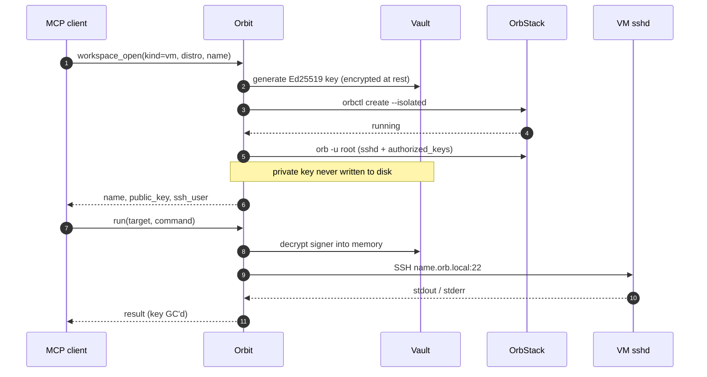

# Orbit

Autonomous agent infrastructure on OrbStack: an MCP server that lets an agent
generate its own SSH keys, spin up isolated Linux VMs, run containers and
nested microVMs, reconcile desired state, and tear resources down — with all
secrets held in a local encrypted vault.

macOS + [OrbStack](https://orbstack.dev) only. Not affiliated with other
projects named Orbit (for example [schmitech/orbit](https://github.com/schmitech/orbit)).

License: [MIT](LICENSE).

Full design: [ORBIT_SPEC.md](ORBIT_SPEC.md).
System design + ADRs: [docs/](docs/).
Technical walkthrough (open in a browser): [orbit-presentation.html](orbit-presentation.html).
Performance and feature roadmap: [ROADMAP.md](ROADMAP.md).

> **Note:** the spec was originally written for TypeScript/Node. This
> implementation is in **Go**, chosen deliberately:
> - `golang.org/x/crypto/ssh` keeps decrypted private keys **in memory only**
>   (the spec's tmpfile workaround for shelling out to `ssh` is unnecessary)
> - Argon2id, AES-256-GCM, and Ed25519 are stdlib / `x/crypto` — no native addons
> - `modernc.org/sqlite` is pure Go, so the result is a single cgo-free binary




## Layout

```
cmd/orbit/           MCP server entrypoint (stdio transport)
cmd/smoke/           end-to-end smoke test against real OrbStack
internal/vault/      encrypted credential store: Argon2id + AES-256-GCM + SQLite
internal/keys/       Ed25519 keypair generation + vault-backed key manager
internal/vm/         orbctl wrapper + provisioner
internal/exec/       SSH task runner (exec, scripts, SFTP push/pull, parallel)
internal/container/  Docker + Compose on OrbStack with vault secret injection
internal/microvm/    nested QEMU/TCG guests (own kernel) for eBPF and kernel-level work
internal/state/      declarative desired-state reconciliation over VMs, containers, and compose
internal/tools/      MCP jobs (run, workspace_*, service_*, file_*, secret_put, converge) and orbit:// resources
internal/audit/      JSONL audit log of every tool call
internal/keychain/   master passphrase via env or macOS Keychain
```

## Requirements

Orbit is a **macOS + OrbStack** tool by design:

- **macOS** — the master passphrase is stored in the macOS Keychain via the
  `security` CLI. On other platforms Orbit will not start unless you set
  `ORBIT_PASSPHRASE` yourself (it fails fast with a clear message rather than
  silently using an insecure default).
- **[OrbStack](https://orbstack.dev)** — VM lifecycle uses the `orbctl`/`orb`
  CLIs and containers use OrbStack's bundled Docker engine (`docker` /
  `docker compose`). These must be on `PATH`.
- **Go 1.25+** to build.

## Install

See [INSTALL.md](INSTALL.md) for the full guide. Quick start:

**Developers:** build locally:

```sh
go build -o bin/orbit ./cmd/orbit
claude mcp add orbit -- $PWD/bin/orbit
```

For Codex / ChatGPT Work, I build the binary somewhere stable and register it
in `~/.codex/config.toml`:

```toml
[mcp_servers.orbit]
command = "/absolute/path/to/orbit"
startup_timeout_sec = 120
```

After I restart or reload Codex, I read `orbit://info` to confirm the active
server version and paths, then `orbit://doctor` to check OrbStack, Docker, and
vault/audit path readiness.

Or, once the module is published:

```sh
go install github.com/machugram/orbit/cmd/orbit@latest
```

Configuration (all optional):

| Env var | Default | Purpose |
|---------|---------|---------|
| `ORBIT_VAULT_PATH` | `~/.orbit/vault.db` | vault location |
| `ORBIT_AUDIT_PATH` | `~/.orbit/audit.log` | audit log location |
| `ORBIT_PASSPHRASE` | — | vault passphrase; if unset, one is generated and stored in the macOS Keychain on first run (`orbit-vault`) |

## Vault

- SQLite file, master key derived via Argon2id (salt=32B, m=65536 KiB, t=3, p=4)
- Every secret encrypted with AES-256-GCM under a fresh 12-byte IV
- A `vault_meta` table stores the salt and an encrypted canary so a wrong
  passphrase is rejected at open time instead of decrypting to garbage
- `credentials` and `vms` tables follow the schema in spec §3; a `microvms`
  table records nested guests (carrier, image, forwarded SSH port, key_id)
- Public keys are derived from the (decrypted) private key on demand rather
  than stored plaintext — strictly less material on disk than the spec

## Security model

- VMs are created with `orbctl create --isolated` (no macOS file sharing)
- Private keys never touch disk unencrypted: decrypted only into process
  memory for the lifetime of an SSH connection
- SSH goes directly to each VM's own sshd (`<machine>.orb.local:22`, user
  `agent`). The spec assumed OrbStack's `127.0.0.1:32222` multiplexer could
  be used, but it authenticates only with OrbStack's host key and ignores
  in-VM `authorized_keys` — using it would collapse all VMs onto one
  credential.
- Every tool call is appended to the audit log (no secret values logged)
- `orbit://secrets` lists names, never values
- `secret_put` stores a value and does not return it. `run` and `service_up`
  take `secret_env` (env-var name → vault name) so the value stays out of the transcript

**Known limitation — SSH host keys are trust-on-connect.** Orbit does not
verify a VM's SSH host key (`InsecureIgnoreHostKey`). This is a bounded,
deliberate decision: all VM traffic stays on the local machine (loopback via
`.orb.local`), and an attacker able to MITM loopback already controls the host
and its vault. Trust-on-first-use (TOFU) pinning is planned and is
a prerequisite before any VM is exposed off-loopback.
Full reasoning: [ADR-011](docs/adr/ADR-011-ssh-host-key-trust-model.md).

## Provisioning (multi-distro)

`workspace_open` with `kind=vm` works across every OrbStack distro family with no
configuration. The spec assumed cloud-init (§4), but OrbStack only ships
cloud-init in its Debian/Ubuntu images — Alpine, Fedora, Arch, etc. have
none. Instead, after `orbctl` creates the machine (and the `agent` user
natively), a single auto-detecting root script is run via `orb`:

1. installs an OpenSSH server with whatever package manager is present
   (`apt`/`dnf`/`yum`/`zypper`/`pacman`/`apk`/`xbps`)
2. generates host keys and installs the agent's `authorized_keys`
3. unlocks the agent account — `orbctl` creates it password-locked (`!`),
   which OpenSSH refuses even for pubkey auth
4. enables sshd under whatever init system exists (systemd / OpenRC / runit)

See [internal/vm/distro.go](internal/vm/distro.go). Verified end-to-end
against Alpine (OpenRC/musl), Fedora (systemd/dnf), and Ubuntu
(systemd/apt). NixOS is the known exception — its declarative model needs
custom handling.

## Containers

Alongside full VMs, the agent can drive OrbStack's built-in Docker engine
for fast, ephemeral work (containers start in 1–3s vs ~30–60s for a
provisioned VM). `service_up` / `service_down` and `run` drive
`docker` and `docker compose`:

| Call | What Orbit does |
|------|-----------------|
| `run` with no target | `docker run --rm` and return stdout, stderr, and the exit code |
| `service_up` with `image` | start a detached container and return its `name.orb.local` address |
| `service_up` with `project` | `docker compose up -d` from a file or inline YAML, then return endpoints. `build` builds images first |
| `service_down` | remove the container, or `docker compose -p <project> down` |
| `run` with `target` | exec into that workspace |

**Vault secret injection** is the reason to use these over the raw CLI. A
container's environment can reference a vault secret by name via `secret_env`
(e.g. `{"POSTGRES_PASSWORD": "prod-db-pw"}`). Orbit reads the value from the
vault at run time and hands it to Docker through a **bare `-e NAME` flag**,
with the value placed only in the docker subprocess's own environment — so
the secret never appears in the model's context, in the command line
(`ps`/argv), or in the audit log. The model only ever sees the env-var name
and the vault key name. See [internal/container](internal/container) and
[ADR-005](docs/adr/ADR-005-container-tools-vault-injection.md).

> Containers share the OrbStack Linux VM kernel, so they are less isolated
> than `orbctl --isolated` VMs. For untrusted code, use `run` with `isolation=vm` or `workspace_open` `kind=vm`; for
> builds, tests, and ephemeral service tasks, containers are faster.

## Nested microVMs (eBPF and kernel-level work)

On Apple Silicon every OrbStack machine — VM or container — shares **one**
kernel. That is wrong for anything that loads code *into* the kernel: an eBPF
program loaded inside a machine attaches to the kernel shared by every other
machine and by OrbStack itself, so it is not contained.

`workspace_open` with `kind=microvm` solves this by booting a **nested QEMU guest with its own
kernel** inside a carrier VM:

```
macOS host → OrbStack shared kernel (carrier, --isolated) → QEMU → nested guest kernel
                                                                     ↑ eBPF runs here, contained
```

```sh
# 1. open a carrier VM, 2. open a nested guest inside it (default: light Alpine)
workspace_open kind=vm distro=ubuntu name=carrier
workspace_open kind=microvm carrier=carrier name=bpf-lab image=alpine
# 3. run in it by name:
run target=bpf-lab interpreter=bash script="bpftrace -e 'tracepoint:syscalls:sys_enter_execve { printf(\"%s\\n\", comm); }'"
```

The guest is reached over SSH at `<carrier>.orb.local:<port>` (QEMU forwards a
carrier-local port into the guest), so `run`, `file_put`, and `file_get` target
a microVM by name.

`run` accepts `secret_env` (`ENV_NAME` -> vault key) so a command can receive
secrets from the vault. Orbit injects them over SSH stdin or into the container
environment and logs only the environment variable names; see
[ADR-014](docs/adr/ADR-014-exec-secret-env.md). `workspace_close` deletes the guest and its key.

> **There is no `/dev/kvm` inside an OrbStack machine, so the guest runs under
> QEMU TCG (software emulation): correct and fully isolated, but the emulated CPU
> is slow.** To keep that cheap, the default `alpine` image boots **direct-kernel**
> (no UEFI, OpenRC not systemd, minirootfs with the agent key baked in) so a boot
> is tens of seconds and tens of MB. Its stock kernel may lack BTF, so for
> out-of-the-box CO-RE eBPF (libbpf/bpftrace) use `image=ubuntu`, a full cloud
> image with a BTF kernel (larger, minutes to boot). The carrier must be a
> Debian/Ubuntu machine. Full reasoning and the trigger for switching to KVM if
> it ever becomes available:
> [ADR-012](docs/adr/ADR-012-nested-microvm-ebpf-isolation.md).

## Desired state

`converge` takes a JSON document and creates whatever it names that is missing.
Already-running resources are left untouched. Nothing is deleted; `workspace_close`
and `service_down` do that.

The document has three arrays — `vms` (name + distro), `containers` (image,
optional name/ports/env), `composes` (project + file path or inline YAML).
Nested microVMs are opened with `workspace_open`. The MCP schema exposes those
fields directly, and validation is shared with file parsing through
`State.Validate()` (see [ADR-013](docs/adr/ADR-013-typed-state-schema-and-diagnostics.md)).
See [internal/state](internal/state).

## Resources

| URI | What I read |
|-----|-------------|
| `orbit://info` | the loaded server version, platform, vault path, and audit path |
| `orbit://doctor` | macOS, OrbStack, Docker, and path readiness |
| `orbit://workspaces` | VMs, microVMs, and containers that exist now |
| `orbit://secrets` | secret names, never values |

These are MCP resources, so checking the loaded server does not spend a tool call.

## Development

```sh
go test ./...            # unit + integration tests (no OrbStack needed)
go run ./cmd/smoke       # real end-to-end: creates + destroys one VM
```

The exec tests run against an in-process SSH+SFTP server; the vm tests
against a scripted fake orbctl; the container tests against a fake docker
runner. `cmd/smoke` touches real OrbStack, and
`ORBIT_DOCKER_E2E=1 go test ./internal/container/` runs one real container
through Docker to verify vault secret injection end-to-end.

## Build plan status

| Session | Goal | Status |
|---------|------|--------|
| 1 | Project scaffold + vault | done |
| 2 | Key generation | done |
| 3 | VM manager | done |
| 4 | Cloud-init provisioner | done |
| 5 | Task runner | done |
| 6 | MCP server wiring | done |
| 7 | Parallel exec + file ops | done |
| 8 | Polish + smoke test | done |
| 9 | Container + compose tools | done |
| 10 | Nested microVMs | done |
| 11 | Desired-state reconciliation | done |
