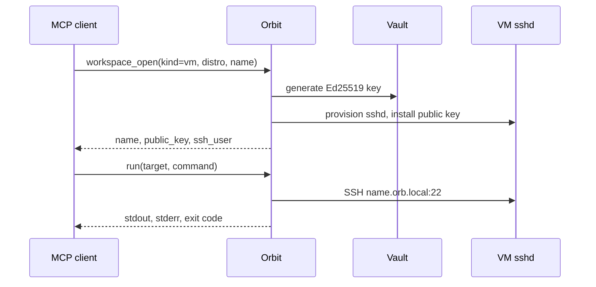

# Using Orbit

Operator reference for the MCP server. The project introduction is the [README](../README.md). Install steps are in [INSTALL.md](../INSTALL.md).

## Tools

Nine tools. Inventory and diagnostics are resources.

| Tool | Job |
|------|-----|
| `run` | Run a command or script. No target: throwaway container, removed after. `isolation=vm` (~1 min) or `microvm` (minutes, needs `carrier`) when the work needs a machine or its own kernel. `target` keeps the workspace. `targets` runs one command on several existing workspaces. |
| `workspace_open` | Open a container, VM, or microVM. Returns the name, address, and SSH public key. Starts it if it already exists and is stopped. |
| `workspace_close` | Destroy the workspace and delete its SSH key. |
| `service_up` | Start a container (`image`) or a compose stack (`project` plus `yaml` or `file`) and return its address. `build` builds compose images first. |
| `service_down` | Stop a container (`name`) or a compose project (`project`). |
| `file_put` | Write a file. `content` for text, `content_base64` otherwise. Capped at 32 MiB. |
| `file_get` | Read a file back the same way. |
| `secret_put` | Store a secret under a name. The value is not returned. |
| `converge` | Create VMs, containers, and compose stacks named in `state` that are missing. Does not delete. |

`run` and `service_up` take `secret_env`: an environment-variable name mapped to a vault name. Orbit injects the value and logs the name only.

| Kind | When | Cost |
|------|------|------|
| container | builds, tests, published services | seconds, shares the OrbStack kernel |
| vm | untrusted code, a real userspace | about a minute, `orbctl --isolated` |
| microvm | eBPF or anything that loads into a kernel | minutes, QEMU inside a Debian/Ubuntu carrier |



A container workspace is a shell (`docker run -d sleep infinity`). Use `service_up` when the process should publish ports. `workspace_close` removes a container or a machine. `service_down` removes a compose project.

## Resources

| URI | Returns |
|-----|---------|
| `orbit://info` | version, platform, vault path, audit path |
| `orbit://doctor` | macOS, `orbctl`, `docker`, and whether the vault and audit directories are writable |
| `orbit://workspaces` | live workspaces. Warm bases (`orbit-base-*`) are omitted |
| `orbit://secrets` | secret names, never values |

Read `orbit://info`, then `orbit://doctor`, after the MCP client reloads.

## Configuration

| Env var | Default | Purpose |
|---------|---------|---------|
| `ORBIT_VAULT_PATH` | `~/.orbit/vault.db` | vault file |
| `ORBIT_AUDIT_PATH` | `~/.orbit/audit.log` | JSONL audit log |
| `ORBIT_PASSPHRASE` | macOS Keychain `orbit-vault` | required off macOS; generated on first macOS run if unset |
| `ORBIT_AGENT_NAMESPACE` | `default` | vault namespace for this process. Warm bases stay shared |

Off macOS the process exits unless `ORBIT_PASSPHRASE` is set.

Codex reads `~/.codex/config.toml`:

```toml
[mcp_servers.orbit]
command = "/absolute/path/to/orbit"
startup_timeout_sec = 120
```

## Secrets and keys

`secret_put` writes a name. Nothing reads the value back. For containers, Orbit passes Docker a bare `-e NAME` and puts the value only in the subprocess environment, so it stays out of argv and `ps`. For SSH, the remote command is `sh -s` and the value travels as `export` on stdin. [ADR-005](adr/ADR-005-container-tools-vault-injection.md), [ADR-014](adr/ADR-014-exec-secret-env.md).

Private keys stay in the vault (Argon2id, AES-256-GCM, SQLite). `workspace_open` returns the public key. SSH dials `<name>.orb.local:22` as `agent` with that VM's key. OrbStack's multiplexer at `127.0.0.1:32222` ignores in-VM `authorized_keys`, so Orbit dials the VM directly ([ADR-002](adr/ADR-002-direct-ssh-not-multiplexer.md)).

Host keys are accepted on connect (`InsecureIgnoreHostKey`). Traffic stays on loopback via `.orb.local`. Pinning is required before a target is reachable off this machine ([ADR-011](adr/ADR-011-ssh-host-key-trust-model.md)).

Provisioning is a root script over `orb`. OrbStack only ships cloud-init on Debian and Ubuntu, and it drops `--cloud-init` on other distros with no error. The script also rewrites the agent's `/etc/shadow` lock from `!` to `*`, because OpenSSH refuses a valid key while the account is password-locked ([ADR-003](adr/ADR-003-provisioning-script-not-cloud-init.md)).

## Nested microVMs

```
macOS → OrbStack carrier (Debian/Ubuntu, isolated) → QEMU → guest kernel
```

```text
workspace_open kind=vm distro=ubuntu name=carrier
workspace_open kind=microvm carrier=carrier name=bpf-lab image=alpine
run target=bpf-lab command="uname -a"
```

There is no `/dev/kvm` in an OrbStack machine, so the guest is TCG. `image=alpine` boots in tens of seconds and may lack BTF. `image=ubuntu` has a BTF kernel and takes minutes. [ADR-012](adr/ADR-012-nested-microvm-ebpf-isolation.md).

## Layout

```
cmd/orbit/           stdio MCP server
cmd/smoke/           real OrbStack smoke test
internal/vault/      Argon2id + AES-256-GCM + SQLite
internal/keys/       Ed25519 keys, vault-backed
internal/vm/         orbctl, warm bases, provisioner, idle reaper
internal/exec/       SSH pool, scripts, SFTP
internal/container/  docker and compose, secret injection
internal/microvm/    nested QEMU guests
internal/state/      converge
internal/tools/      the nine tools and orbit:// resources
internal/audit/      JSONL log of tool calls
internal/keychain/   passphrase from the environment or macOS Keychain
```

The binary is cgo-free Go. `golang.org/x/crypto/ssh` keeps decrypted keys in memory. `modernc.org/sqlite` avoids a C toolchain.

## Development

```sh
go test ./...            # no OrbStack required
go run ./cmd/smoke       # creates and destroys one real VM
ORBIT_DOCKER_E2E=1 go test ./internal/container/
```

Exec tests use an in-process SSH server. VM tests use a fake `orbctl`. Container tests use a fake `docker`.
